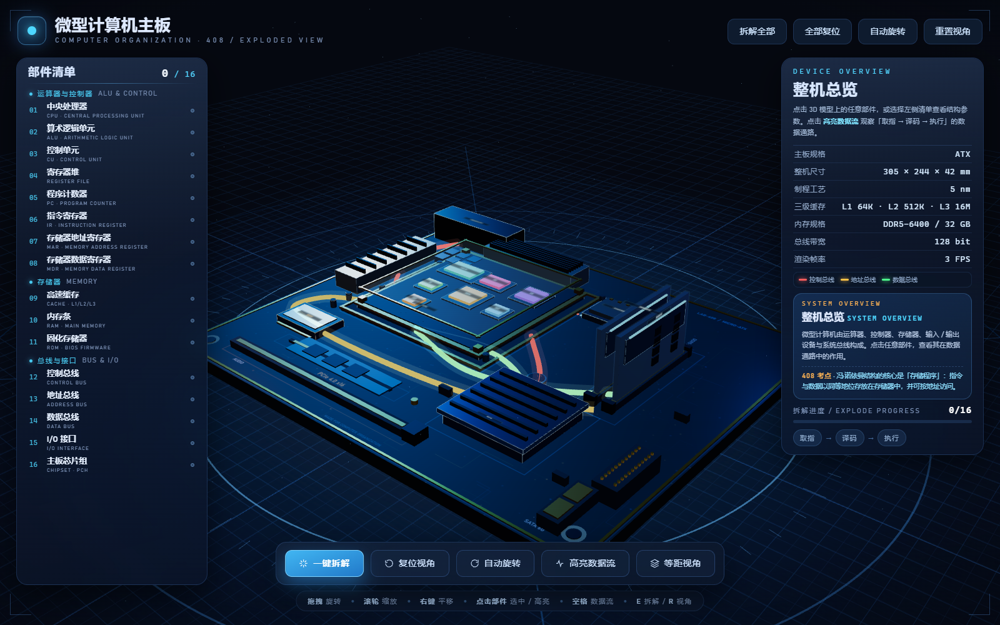

# 计算机组成原理图

微型计算机主板结构与 408 数据通路拆解可视化。



GitHub 仓库：<https://github.com/zwhy-yjw/computer-organization-diagram>

## 文件

| 文件 | 说明 |
| --- | --- |
| `计算机组成原理-结构拆解可视化.html` | 完整单文件页面，双击运行 |
| `计算机组成原理-预览.png` | 装配状态预览 |
| `计算机组成原理-拆解预览.png` | 16 个部件拆解预览 |
| `计算机组成原理-数据流预览.png` | PC → MAR → RAM → MDR → IR → CU → ALU 数据流预览 |
| `_check_extract.mjs` | 单文件静态验收脚本 |

## 运行

直接双击 `计算机组成原理-结构拆解可视化.html`。

页面通过 CDN 加载 Three.js r187 与 TWEEN.js v25.0.0，需要联网。CDN 不可用时会显示重试提示。

## 操作

- 左键拖拽：旋转
- 滚轮：缩放
- 右键拖拽：平移
- 点击 3D 部件或左侧清单：双向高亮
- 一键拆解：16 个部件（含 CPU 内部 7 件套）飞散悬浮
- 高亮数据流：演示取指 → 译码 → 执行
- 自动旋转 / 等距视角 / 复位视角

## 验收

在文件夹内运行：

```powershell
node _check_extract.mjs
```

## Git 与实时推送

`.vscode/` **不是 Git 必需文件**，它只保存编辑器设置，且已写入 `.gitignore`，不会提交到仓库。

本机已额外配置：

- `.vscode/settings.json` 中开启 `git.enableSmartCommit`，提交时自动暂存全部改动
- `git.postCommitCommand: "push"`，每次在 VS Code 中提交后自动推送
- `git.autofetch: true`，自动同步远端状态

所以：在 VS Code 源代码管理里填写提交信息并点击提交，随后会自动 `git push`。GitHub 本身没有“保存文件就自动上传”的机制，自动动作发生在**提交之后**，避免产生大量无意义提交。也可以在终端手动执行：

```powershell
git add -A
git commit -m "更新说明"
git push
```

`.vscode/tasks.json` 还提供了一个本地任务「Git: 提交并推送」，可从 VS Code 的“运行任务”中一键执行。

## CDN 来源

Three.js：`https://cdn.jsdelivr.net/gh/mrdoob/three.js@r187/`

TWEEN.js：`https://cdn.jsdelivr.net/gh/tweenjs/tween.js@v25.0.0/`

均为 GitHub 仓库文件服务，不使用 npm 安装，不依赖本地构建。
